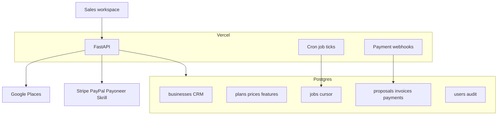

# AppointHive Sales OS — Locked Implementation Plan

**Status:** Implemented (P0–P5 + gap pass); known limits in `docs/LIMITATIONS.md`  
**Tests (2026-10-25):** `pytest tests/` → **34 passed**  
**Codebase:** `maps-lead-finder` (extend; do not rebuild `lead-crm`)  
**Deploy target:** Vercel + Postgres (Neon) only — no Redis, RabbitMQ, or worker fleet  
**Product:** Internal AppointHive sales CRM (not sold as a CRM product)

---

## 1. Intent

Make money selling AppointHive by helping humans:

1. Find prospects (multi-market; Australia first operationally, not hard-coded).
2. Contact and follow up consistently.
3. Demo and propose honestly (3 standalone plans; catalog editable).
4. Invoice + payment links (Stripe, PayPal, Payoneer, Skrill, manual bank).
5. Know hope vs signed vs **cash collected**.
6. Hire a second salesperson without sharing Owner powers.
7. Later open **SaaS** as a **separate** product line (standalone continues).

**Non-intent:** Do not sell this CRM. Do not rebuild lead-crm. Do not auto mass-mail or scrape behind logins. Do not invent customers/ROI in templates.

---

## 2. Locked decisions

| Topic | Decision |
|-------|----------|
| Domain model | Extend `businesses` as prospects; keep Places fields |
| Product lines | `STANDALONE` \| `SAAS`; one prospect = one line; dual sell = two linked rows |
| Auth | `users` table early; seed Owner `hello@appointhive.com`; roles Owner / Sales / Viewer |
| Money | Collected = succeeded payments − refunds; `won_on=first_payment` default |
| Payments | Adapters: stripe, paypal, payoneer, skrill, manual |
| Markets | Country-driven currency, tax, compliance; company timezone editable |
| Jobs | Postgres `jobs` + tick endpoint / Cron (no Redis) |
| Migrations | Additive `005+` SQL files; preserve existing data |
| UI | Proper multi-panel sales workspace; reuse theme tokens; accessible, responsive |
| Quality | Fully tested (pytest); no claim of pass without running |

---

## 3. Current baseline

| Area | Today |
|------|--------|
| Entry | `uvicorn app.main:app`; Vercel `index.py` |
| Code | Monolith `app/main.py` + `app/templates/index.html` |
| Schema | `businesses`, `message_templates`, `activity_log`, migrations `001`–`004` |
| Pipeline | Booleans: marked / contacted / lost / archived + follow-up date |
| Auth | Shared HMAC cookie login |
| Tests | None |

Preserve: Places search/enrich, compose → confirm-sent, CSV, templates, existing Neon/`local-dev.db` via backfill.

---

## 4. Target architecture

```text
app/
  main.py              # app factory + router includes
  config.py
  db.py
  auth/                # session, require_login, roles
  models/
  schemas/
  services/
    pipeline.py
    scoring.py
    metrics.py
    catalog.py
    compliance.py
    billing/           # stripe, paypal, payoneer, skrill, manual
    import_csv.py
    jobs.py
  routers/             # one module per domain
  templates/ | static/ # workspace UI modules
  migrations/005_*.sql ...
tests/                 # pytest + TestClient
docs/                  # this plan, metrics dictionary, setup
```



---

## 5. Data model

### 5.1 Core entities

- **User** — email, name, role (`owner|sales|viewer`), timezone, active  
- **Business (prospect)** — existing Places columns + CRM columns below  
- **PipelineStage** — per `product_line`, sort_order, probability, terminal  
- **StageHistory** — from/to, at, by, note  
- **Contact** — people at prospect  
- **Activity** — typed timeline (cut over from `activity_log`)  
- **Task** — follow-ups (never deleted on stage change)  
- **QualificationScore** — 5 criteria × 0–2, override, verified_at  
- **DiscoveryNote / DemoNote**  
- **Plan / PlanPrice / PlanFeature** — catalog (3 standalone plans seeded)  
- **Proposal** + line snapshots + versions  
- **Invoice** — provider, URLs, status, expiry, billing_entity_id  
- **Payment** — amount, currency, status, provider refs, refunds  
- **WebhookEvent** — unique provider event id (idempotent)  
- **BillingEntity** — seller legal name, address, tax ids  
- **CompliancePack** — per country  
- **Suppression** — email / phone / domain  
- **AppSettings** — flags, maps, won_on, reporting currency  
- **SalesTerritory** — country[, region] → owners  
- **AuditEvent**  
- **Job** — type, cursor, status for Places/CSV chunks  
- **LinkedProspect** — `linked_prospect_id` for cross product-line  

### 5.2 Prospect CRM columns (additive)

`product_line`, `pipeline_stage_id`, `owner_id`, `state`, `postcode`, `timezone`, `deal_value`, `currency`, `estimated_close_date`, `next_action`, `lead_source`, `date_identified`, `last_verified_at`, staff/locations/booking software fields, qualification fields, objections, lost_reason, opt_out / channel permissions, tax_id, billing address fields, `linked_prospect_id`, terms acceptance metadata.

### 5.3 Backfill

| Current | Target |
|---------|--------|
| Default / unmarked | Identified |
| `marked_for_contact` | Ready to Contact |
| `contacted` | Contacted |
| `lost` | Lost |
| `archived` | Keep as hide filter (not Lost) |
| `next_follow_up_at` | Create Task + keep timestamp |
| — | `product_line=STANDALONE` |

### 5.4 Standalone stages

Identified → Ready to Contact → Contacted → Follow-up → Engaged → Qualified → Demo Scheduled → Demo Completed → Proposal Sent → Negotiation → Won / Lost / Nurture  

### 5.5 SaaS stages (seeded; UI behind `saas_enabled`)

Identified → … → Trial Offered → Trial Active → Subscribed → Past Due → Churned → Lost → Nurture  

---

## 6. The 15 checklist items (must ship)

| # | Item | Phase |
|---|------|-------|
| 1 | Billing entity / seller profiles on invoices | P2d |
| 2 | Refunds / chargebacks adjust Collected | P2d |
| 3 | Quote/invoice expiry + unpaid → auto follow-up task | P2d / P5 |
| 4 | Suppression list (email / phone / domain) | P2 |
| 5 | Duplicate UI: suggest / link / ignore / merge (Owner only; no blind merge) | P2 |
| 6 | Global search + saved views | P1 / P3 |
| 7 | Terms acceptance URL on proposal/invoice | P2 |
| 8 | Test vs live payment mode banner | P2d |
| 9 | Idempotent invoice create + webhook event ids | P2d |
| 10 | Linked prospects across STANDALONE / SAAS | P0 / P4 |
| 11 | Accountant CSV export (payments/invoices) | P2d |
| 12 | Attachment **links** v1 (object store later) | P2 |
| 13 | Demo-data flag + wipe | P0 / P5 |
| 14 | `won_on` setting (`first_payment` default; `acceptance` allowed) | P0 / P2d |
| 15 | Template content governance (no invented social proof) | P2 |

---

## 7. Payments

### Providers

| Provider | Auto link | Auto paid | Notes |
|----------|-----------|-----------|--------|
| Stripe | Yes | Webhook | Primary |
| PayPal | Yes | Webhook | Primary |
| Payoneer | Partial | Webhook if available else Owner confirm | In scope |
| Skrill | Limited | Notify or Owner confirm | In scope |
| Manual bank | Instructions | Owner confirm only | In scope |

### Flow

1. Proposal ready → Generate invoice (snapshot lines + tax + billing entity).  
2. Choose provider → hosted URL or pay instructions + reference.  
3. Customer pays → webhook or Owner confirm → Payment succeeded → activity → Won per `won_on`.  
4. Collected dashboard updates; refunds reverse into net collected.  
5. Never store card numbers. Test mode never mixes into live totals.

Env names only in `.env.example`: `STRIPE_*`, `PAYPAL_*`, `PAYONEER_*`, `SKRILL_*`, webhook secrets.

---

## 8. Markets, catalog, compliance

- **Markets enabled** in Settings: AU, NZ, US, CA, Europe packs, Middle East packs (start UAE).  
- **Currency-by-country** map; per-deal override; reporting currency optional.  
- **Timezone:** user timezone for due today; company default editable; prospect optional.  
- **Catalog:** 3 standalone plans with features + multi-currency prices; changes create new price rows; proposals freeze snapshots.  
- **Compliance packs:** privacy, marketing/spam, tax invoice cues, required permission fields; enforce opt-out; red banner if not counsel-reviewed. Not legal advice.  
- **SaaS:** same catalog tables; flag off until P4.

---

## 9. UI / UX requirements (proper sales workspace)

### 9.1 Principles

- One clear job per screen; fast keyboard path for daily sales.  
- Reuse existing CSS variables / dark navy theme; improve hierarchy — do not invent a second visual language.  
- Responsive: usable on laptop and phone for tasks/prospect detail.  
- Accessible: labels, focus states, confirmations, no color-only status.  
- Empty / loading / error states on every list.  
- No fake data in production views; demo data labeled + removable.  
- Honest integration status (Places / pay providers): show configured vs not — never fake “connected”.

### 9.2 Navigation

Dashboard · Discover · Pipeline · Prospects · Tasks · Activities · Demos · Proposals · Invoices & Payments · Reports · Import/Export · Templates · Settings · Audit (Owner)

### 9.3 Key UX flows

| Flow | UX bar |
|------|--------|
| Morning | Dashboard queues: Overdue → Due today → Due soon → No next action → Uncontacted qualified → Open invoices unpaid |
| Discover | Keep search UX; new leads land Identified + STANDALONE; country required |
| Pipeline | Kanban + list toggle; stage column counts + value; drag or accessible move control |
| Prospect | Single scrollable detail: overview, score, contacts, compliance side panel, timeline, tasks, money |
| Outreach | Template preview → copy; blocked with reason if opted out / missing required compliance fields |
| Close | Plan picker → proposal → invoice → copy pay link → paid state visible without refresh games |
| Team | Assign owner; Sales cannot edit payments/settings/catalog prices |

### 9.4 Visual / interaction

- Clear stage badges and money badges (Open / Invoiced / Paid / Refunded).  
- Test-mode stripe/banner when any provider is test.  
- Destructive actions: confirm modal.  
- Toasts for success/failure; inline validation on forms.  
- Saved views chips (e.g. AU Standalone open).  
- Global search (Cmd/Ctrl-K or header search) across prospects, tasks, invoices.

---

## 10. Screens and APIs (summary)

**Pages:** as nav above.  
**API domains:** `/api/pipeline/*`, `/api/prospects/*`, `/api/tasks/*`, `/api/activities/*`, `/api/catalog/*`, `/api/proposals/*`, `/api/invoices/*`, `/api/payments/*`, `/api/webhooks/{provider}`, `/api/compliance/*`, `/api/import/*`, `/api/export/*`, `/api/reports/*`, `/api/settings/*`, `/api/users/*`, `/api/jobs/*`, `/api/search`, `/api/audit/*` — all mutating routes behind auth; IDOR by role/owner.

Keep existing Discover/templates/business patch routes working through the split.

---

## 11. Metrics dictionary (implement in services)

| Metric | Definition |
|--------|------------|
| Open pipeline | Sum deal value in open non-terminal stages |
| Weighted forecast | Σ(value × stage probability) — labeled estimate |
| Signed | Won (or SaaS Subscribed) per policy |
| Collected | Succeeded payments − refunds |
| Invoiced outstanding | Invoices status open |
| Reply rate | Prospects with ≥1 reply ÷ contacted (cohort + range; show n) |
| Demo conversion | Demo completed ÷ qualified eligible (show n) |
| Win rate | Won ÷ (Won + Lost) (show n) |

Avoid percentage-first UI when n &lt; 10.

---

## 12. Phased delivery

### P0 — Foundation

- Split modules; app factory; routers; zero regression on Discover/login/CSV/templates.  
- Migrations: users, settings, product_line, stages, stage_history, jobs, linked_prospect_id, demo_data flag, won_on.  
- Seed Owner; bind session to user_id.  
- Backfill stages from booleans.  
- Seed standalone + SaaS stages (SaaS UI hidden).

### P1 — Sell loop + core UX

- Pipeline Kanban + table; filters (product_line, country, owner).  
- Prospect list + detail; contacts; activities; tasks queues.  
- Dashboard work queues.  
- Global search (basic).  
- Discover behavior preserved; large scans via jobs if needed.

### P2 — Qualify, catalog, compliance (+ checklist 4,5,7,12,15)

- Scorecard; discovery/demo notes.  
- 3-plan catalog CRUD; proposals + snapshots; terms URL; attachment links.  
- Compliance packs; opt-out; suppression list; template governance + copy gate.  
- Duplicate detection UI.

### P2d — Billing (+ checklist 1,2,3,8,9,11,14)

- Billing entities; invoices; Stripe/PayPal/Payoneer/Skrill/manual.  
- Webhooks + idempotency; test/live banner; refunds; accountant CSV.  
- Expiry → unpaid follow-up task creation.  
- Apply won_on.

### P3 — Team (+ checklist 6 saved views polish)

- Role enforcement; territories; assignment; audit UI; saved views.

### P4 — SaaS

- Enable flag; SaaS board; SaaS plans; trial/MRR; linked prospects UX; separate reports.

### P5 — Harden + fully tested

- Full pytest suite (section 13).  
- Cron: job ticks + unpaid invoice tasks.  
- README / `.env.example` / metrics doc / known limitations.  
- UI pass: empty/error/loading, mobile tasks, a11y smoke.  
- Run lint, migrations on test DB, pytest — report **actual** results only.

---

## 13. Full testing requirements

### 13.1 Automated (pytest + httpx/TestClient)

- Prospect CRUD, search, filter, archive/delete  
- Qualification score calculation + override  
- Stage transitions + history; invalid transitions with override  
- Activity timeline order  
- Task schedule / complete / overdue / reschedule; survive stage change  
- Proposal totals, discounts, tax, currencies, snapshots  
- Invoice idempotency; payment succeed; refund adjusts collected  
- Webhook replay idempotency (fake signed events in tests)  
- CSV import preview, dedupe, export  
- Opt-out / suppression blocks template copy API  
- Auth: unauthenticated 401; Sales IDOR cannot patch others’ restricted fields; Owner-only payment confirm  
- Persistence: commit visible after new session/engine  
- Jobs tick advances cursor safely  

### 13.2 Manual / checklist QA

- Responsive: dashboard, pipeline, prospect, tasks on narrow viewport  
- Keyboard: tab through forms; confirm dialogs  
- Empty states for new DB  
- Provider test-mode banner visible  
- No fake “paid” without webhook/Owner confirm  

### 13.3 CI expectation

Document commands:

```bash
pytest
# optional: ruff/mypy if added
```

Do not claim green without running.

---

## 14. Out of scope

- lead-crm multi-tenant platform / CRM seat billing / Super Admin marketplace  
- Redis, RabbitMQ, BullMQ, dedicated workers  
- Auto mass-email; scrape behind logins; store cards  
- Xero/QuickBooks sync (CSV only)  
- WhatsApp/Meta Cloud auto-send  
- Equal automation depth for Payoneer/Skrill as Stripe  
- Native mobile apps  
- Deploy without owner approval; contacting real businesses automatically  

---

## 15. Environment variables (names only)

Existing: `DATABASE_URL`, `GOOGLE_MAPS_API_KEY`, `LOGIN_PASSWORD`, `SESSION_SECRET`, `DISCOVER_SOCIAL_LINKS`, compose ports.

Add: `STRIPE_SECRET_KEY`, `STRIPE_PUBLISHABLE_KEY`, `STRIPE_WEBHOOK_SECRET`, `STRIPE_MODE`, `PAYPAL_CLIENT_ID`, `PAYPAL_CLIENT_SECRET`, `PAYPAL_WEBHOOK_ID`, `PAYONEER_*`, `SKRILL_*`, `CRON_SECRET`, optional `RESEND_API_KEY` (later digests only).

---

## 16. Local / deploy commands (post-build)

```bash
cp .env.example .env   # fill secrets locally
docker compose up --build -d
# or: uvicorn app.main:app --reload
pytest
```

Vercel: set `DATABASE_URL` + auth + Places + payment keys; never commit `.env`.

---

## 17. Success criteria (owner)

- [ ] Week of outreach without a side spreadsheet  
- [ ] Every open prospect has next action or appears on No next action  
- [ ] Collected matches live provider/bank reality  
- [ ] Stripe/PayPal pay link flips CRM to paid  
- [ ] Payoneer/Skrill payable without corrupting revenue  
- [ ] AU-first filters; other countries do not break model  
- [ ] Plan price change does not rewrite old proposals  
- [ ] Second salesperson cannot break payments/settings  
- [ ] SaaS flag off until wanted; standalone intact  
- [ ] All 15 checklist items shipped  
- [ ] UI usable on desktop + mobile for core flows  
- [ ] pytest suite run with recorded results  
- [ ] Still Vercel + Postgres only  

---

## 18. Implementation order for Agent

1. P0 Foundation (split + migrations + backfill)  
2. P1 Sell loop + UX shell  
3. P2 Catalog / compliance / checklist items  
4. P2d Billing + remaining money checklist  
5. P3 Team  
6. P4 SaaS  
7. P5 Tests + docs + polish  

**Do not start coding until owner says to implement this plan.**  
When implementing: preserve `local-dev.db` changes; additive migrations only; no deploy; no real outreach automation.

---

## 19. Delivery report template (end of build)

1. Features implemented  
2. Files changed  
3. Migrations created  
4. Env vars required (names only)  
5. Local commands  
6. Tests executed + exact results  
7. Known limitations  
8. Manual config still required  
9. Prioritized next steps  

---

*End of locked plan.*
